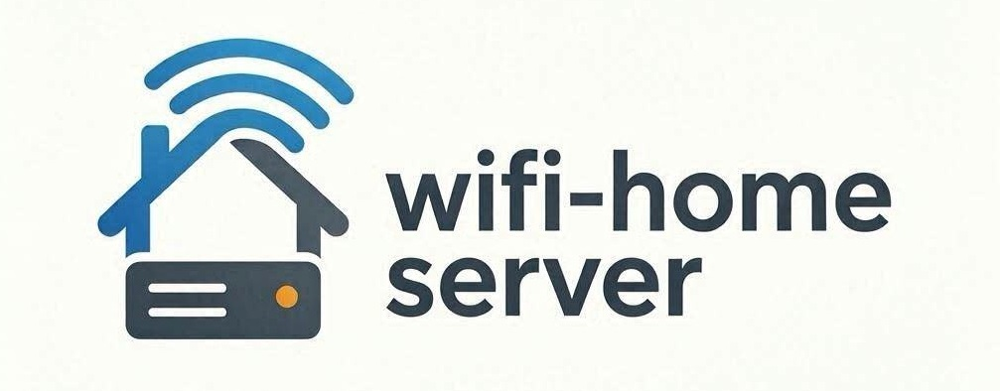
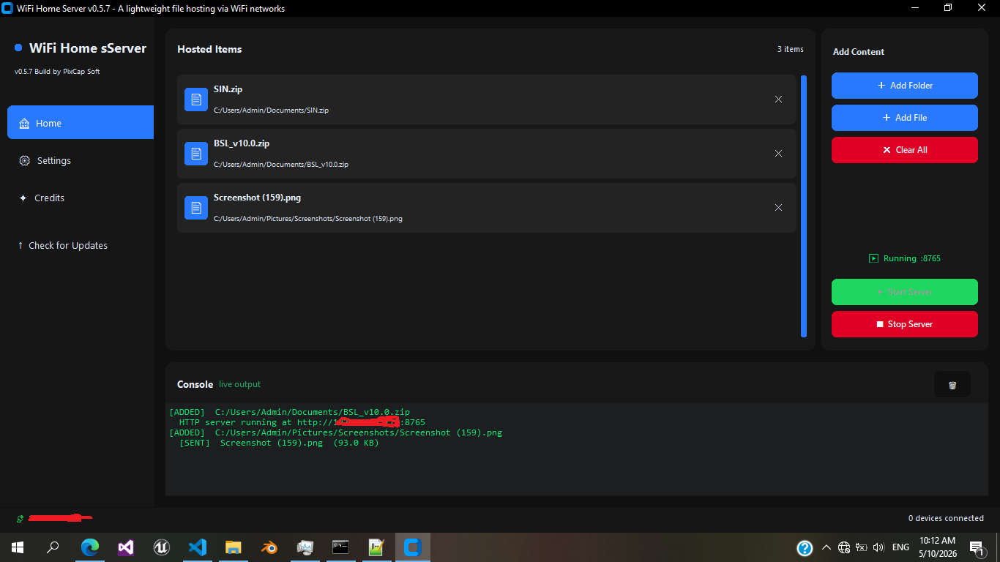
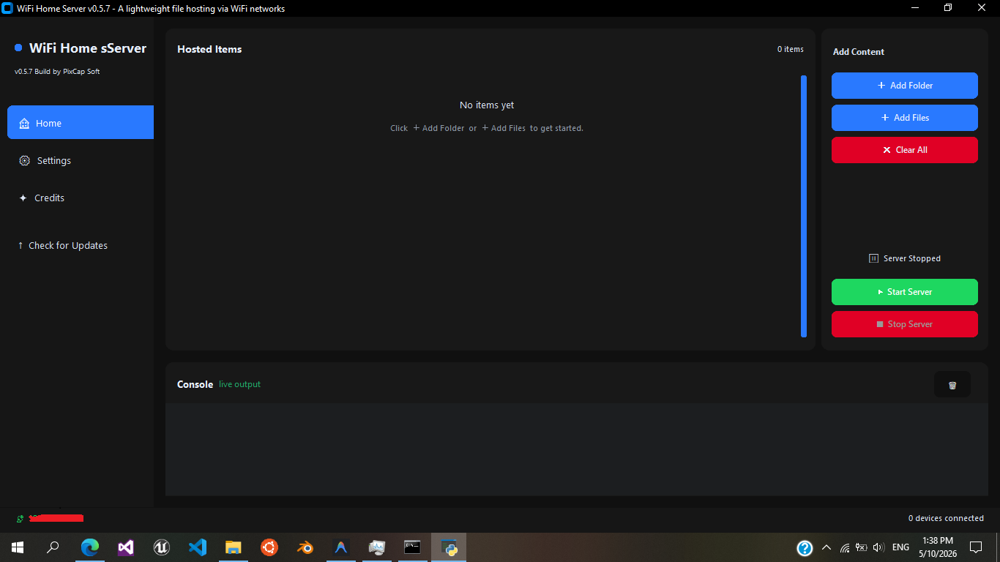
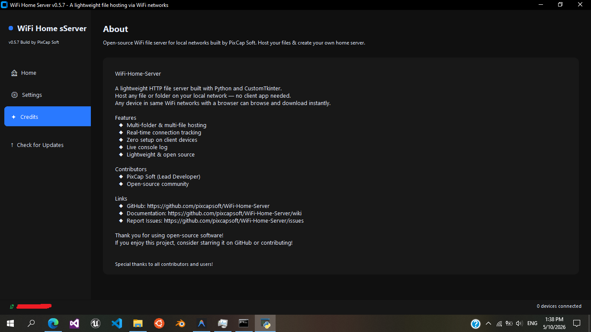

# SecureShare — Secure File Sharing over WLAN

<div align="center">
  
  
  
  
</div>

<br>

> **Micro Project — Introduction to Mobile Computing**
> **Student:** Alan Jaison &nbsp;|&nbsp; **Department:** Electronics and Communication Engineering (ECE)

---

## 📌 Project Description

**SecureShare** is a Python desktop application that lets you share selected files and folders with any device on the same Wi-Fi network using a standard web browser — with **no client app required**.

Unlike a plain HTTP file server, SecureShare adds a complete security layer:

- Files are **never transmitted in plaintext** — every download is AES-256-GCM encrypted.
- A **PBKDF2 challenge-response** login prevents unauthenticated access.
- The browser **verifies the SHA-256 hash** of each decrypted file before saving it.
- The connection is protected by **HTTPS** with a locally generated self-signed certificate.

Files stay on the host machine. The server provides **download-only** access.

---

## 🎯 Project Objectives

1. Implement a **secure, browser-accessible file sharing server** for WLAN environments.
2. Apply **AES-256-GCM authenticated encryption** to protect file content in transit.
3. Use **PBKDF2-HMAC-SHA256** for secure password-based key derivation (600,000 iterations).
4. Perform **SHA-256 integrity verification** client-side after decryption.
5. Enforce **HTTPS** with a per-machine self-signed TLS certificate.
6. Provide a modern, user-friendly **CustomTkinter desktop GUI** for the sender.
7. Require zero configuration on the receiving device (any browser works).

---

## 🛠️ Technologies Used

| Layer | Technology |
|---|---|
| Language | Python 3.11+ |
| Desktop GUI | CustomTkinter (dark-themed tkinter wrapper) |
| HTTP server | Python stdlib `http.server.ThreadingHTTPServer` |
| Encryption | `cryptography` — AES-256-GCM, PBKDF2-HMAC-SHA256, HKDF, ECDSA P-256 |
| TLS | Python `ssl` + auto-generated self-signed certificate |
| Client crypto | Web Crypto API (`SubtleCrypto`) — runs entirely in the browser |
| Hashing | SHA-256 (Python `hashlib` + browser `SubtleCrypto.digest`) |
| Threading | Python stdlib `threading` |
| Networking | Python stdlib `socket`, `urllib` |

---

## ✨ Features & Functionality

| Feature | Description |
|---|---|
| 🔐 Password authentication | Challenge-response login — password never sent over the network |
| 🔒 AES-256-GCM encryption | Every file download is individually encrypted with a fresh nonce |
| ✅ SHA-256 integrity check | Browser verifies hash after decryption; rejects tampered files |
| 🌐 HTTPS transport | Self-signed TLS certificate; fingerprint printed to the console |
| 📁 Multi-item hosting | Share any mix of files and folders simultaneously |
| 📱 Zero-install receiver | Receiver only needs a web browser on the same Wi-Fi |
| 🖥️ Modern dark GUI | CustomTkinter desktop app with live console log |
| 🔄 Session management | 8-hour session cookies; `HttpOnly; Secure; SameSite=Strict` |
| 🛡️ Path traversal guard | All file paths validated against the shared root |

---

## 🔐 Security Architecture

### 1. AES-256-GCM Encryption

```
Browser password
    │
    ▼  PBKDF2-HMAC-SHA256 (600,000 iterations, random 16-byte salt)
password_key  ──► HMAC challenge proof  →  authenticates the login
    │
    ▼  HKDF (info = "SecureShare AES-256-GCM file key")
file_key (256-bit)
    │
    ├── SERVER side:  AESGCM.encrypt(nonce, plaintext, AAD=filename)
    │                 → sends ciphertext + X-File-Nonce header
    │
    └── BROWSER side: SubtleCrypto.decrypt(AES-GCM, iv=nonce, AAD=filename)
                      → produces original plaintext in-browser
```

- **Nonce**: 12 bytes, randomly generated per file download
- **AAD**: filename bytes — binds ciphertext to the specific filename
- **No raw key ever crosses the network** — only the PBKDF2 salt and HMAC proof

### 2. SHA-256 Integrity Verification

1. Server computes `SHA-256(plaintext)` **before** encryption → sends it in `X-File-SHA256` header.
2. Browser decrypts, recomputes `SHA-256(decrypted_bytes)` using `SubtleCrypto.digest`.
3. Compares both values:
   - **Match** → ✅ "Decryption successful. SHA-256 integrity verified."
   - **Mismatch** → ❌ "Integrity verification failed: SHA-256 mismatch."

### 3. Authentication Mechanism

- On login, the server issues a **one-time challenge nonce**.
- The browser derives `password_key` via PBKDF2 locally, then computes `HMAC-SHA256(password_key, nonce)`.
- The server independently computes the same HMAC and compares using `hmac.compare_digest` (constant-time).
- A valid proof creates a **session cookie** (`ss_session`) valid for 8 hours.
- The raw password is **never transmitted** at any point.

---

## 💻 Installation & Usage

### Prerequisites
- Python 3.11 or newer
- Git

### 1 — Clone the repository

```bash
git clone https://github.com/<your-username>/SecureShare.git
cd SecureShare
```

### 2 — Create a virtual environment and install dependencies

```bash
py -3.11 -m venv .venv
.venv\Scripts\python.exe -m pip install -r requirements.txt
```

### 3 — Run the desktop application (Sender / Server)

```bash
.venv\Scripts\python.exe gui.py
```

### 4 — Use the application

1. Click **＋ Add Files** or **＋ Add Folder** to select content to share.
2. Click **▶ Start Server** and enter a password of **at least 12 characters**.
3. The console shows:
   ```
   SecureShare running at https://192.168.x.x:8765
   Certificate SHA-256 fingerprint: AA:BB:CC:...
   ```
4. On the receiving device (browser), navigate to `https://192.168.x.x:8765`.
5. Accept the self-signed certificate warning — verify the fingerprint.
6. Log in with the same password → click **Decrypt and save** on any file.

---

## 🌐 How Devices Connect

| Step | Action |
|---|---|
| 1 | Both devices must be on the **same Wi-Fi network** |
| 2 | Note the URL and certificate fingerprint from the sender's console |
| 3 | Open the URL in any modern browser on the receiving device |
| 4 | Accept / trust the self-signed certificate (verify fingerprint first) |
| 5 | Log in, browse files, download — decryption happens in the browser |

---

## 🧪 Running Tests

```bash
.venv\Scripts\python.exe -m pytest test_security.py -v
```

Tests cover:
- AES-256-GCM encrypt/decrypt correctness
- Wrong-key and tampered-ciphertext rejection
- Full HTTPS authenticated download with SHA-256 verification

---

## 📸 Screenshots

> **Home Panel** — hosted items and server controls



> **Credits Panel**


---

## 🛡️ Security & Privacy

- The server binds to `0.0.0.0` — use on **trusted networks only**.
- Use a **unique, strong password** (≥ 12 characters) for every session.
- The self-signed TLS certificate and private key are stored in `%APPDATA%\SecureShare` and are **never committed** to this repository.
- Files larger than **256 MiB** are not supported (in-memory encryption limit).
- This application has not been independently audited. See [SECURITY.md](SECURITY.md) for full limitations.

---

## 🤝 Contributing

Contributions are welcome! Please read [CONTRIBUTING.md](CONTRIBUTING.md) before opening a pull request.

---

## 📄 License

This project is open-source under the [Apache License 2.0](LICENSE).

Originally based on [WiFi-Home-Server](https://github.com/pixcapsoft/WiFi-Home-Server) by PixCap Soft.
SecureShare additions (AES-256-GCM, SHA-256, HTTPS, authentication) by Alan Jaison, ECE.

<div align="center">
  <sub>Built with ❤️ on top of WiFi-Home-Server by PixCap Soft and the Open Source Community</sub>
</div>
